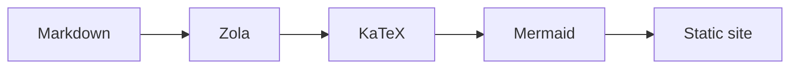
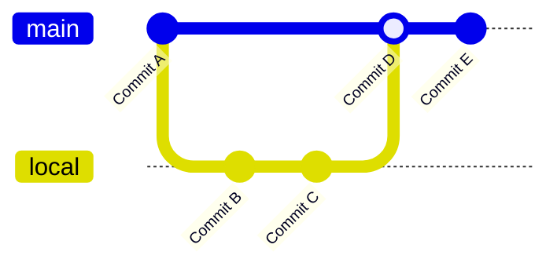

+++
title = "Wiki-like"
[extra]
show_subpages = true
+++

Welcome to the [Wiki-like](https://github.com/aterenin/wiki-like/) Zola theme! This theme is designed for hosting any content which is best viewed in a style similar to Wikipedia.[^1]

[^1]: This theme supports displaying numbered footnotes as sidenotes.

# Features 

[Wiki-like](https://github.com/aterenin/wiki-like) is designed for most features you would need for content that would be displayed in the style of a wiki. This includes:

* A Wikipedia-inspired layout with a navigation menu on the left, and appropriate styling for lists, tables, quotations, code blocks, and other content that is well-suited to a theme of this kind.
* Math via [KaTeX](https://katex.org). KaTeX inline math is written `` `$x$` `` and display-style math is written `` ```$$ ... $$``` `` inside triple-backticks over multiple lines, with no language label. A client-side rendering script is included on all pages where this syntax is used, but rendering can instead be done server-side or disabled.
* Diagrams via [Mermaid](https://mermaid.js.org). These are written inside triple backticks as in `` ```mermaid ... ``` ``. A client-side rendering script is included on all pages where this syntax is used, but rendering can instead be done server-side or disabled.
* Both KaTeX math and Mermaid diagrams can be rendered server-side. This is done by running a pair of Node scripts after `zola build` has completed. A deploy script for building with these features is included, which enables them if an appropriate option is set in `Zola.toml`.
* They can also be disabled entirely, even if the respective syntax is used, by creating blank files called `templates/includes/katex.html` and `templates/includes/mermaid.html` in your site's code.
* Footnotes that are numbered rather than named, using `[^1]` and similar, will render as sidenotes rather than footnotes.
* Please open a GitHub issue if there is another type of content that you would like to display using this theme, but it is not supported natively.

***

The content below the asterism[^2] serves as a test of the theme's CSS.[^3]
Note that numbered[^4] and named[^footnote] footnotes behave differently: numbered footnotes are rendered as sidenotes---by default 25 sidenotes are included in CSS, but this can be increased by overriding the variable `$max-footnotes`.

[^2]: The asterism is typeset via `***`, and this line also serves as a test of footnotes, which are displayed as sidenotes.
[^3]: This also serves as a test of footnotes.

> We also support quotation blocks, via `>`.

## Tables

| Column 1 | Column 2 | Column 3 |
|----------|----------|----------|
| Entry A  | Entry B  | Entry C  |
| Entry D  | Entry E  | Entry F  |
| Entry G  | Entry H  | Entry I  |

## Code

A code block:

```rust
fn main() {
    println!("Hello, world!");
}
```

## Math

Math can be typeset inline as `` `$x$` `` to obtain `$x$` and as display style with 
```tex
$$
f(x) = y
$$
```
to obtain 
```
$$
f(x) = y
$$
```
and we also include a second display to check alignment:
```
$$
\begin{aligned}
f_1(a) &= w
&
f_2(b) &= x
\\
f_3(c) &= y
&
f_4(d) &= z
.
\end{aligned}
$$
```

## Diagrams

A flowchart, which tests wider diagrams:



A git diagram, which tests narrower ones:



[^4]: This tests numbered footnotes placed in Markdown at the very end of the document, but which still appear as sidenotes.
[^footnote]: This tests named footnotes, which always appear at the end of the document.